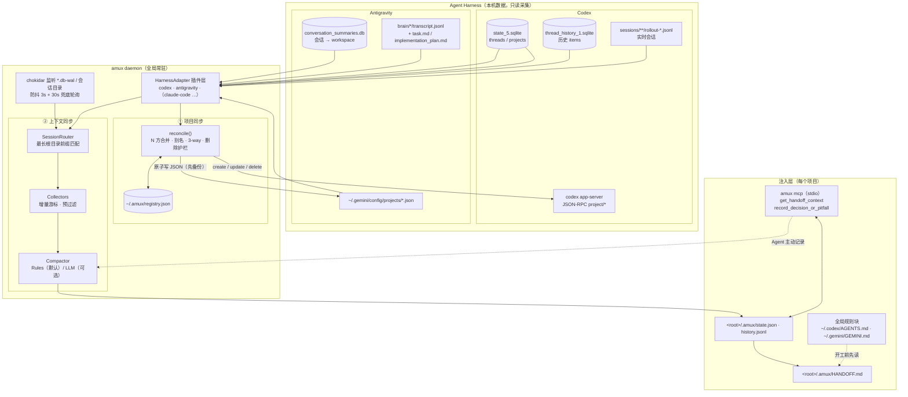

# amux — Agent Multiplexer

> AI Coding Agents 界的 `tmux`：让 **Codex**、**Antigravity**（以及未来更多 Agent Harness）在同一台电脑上**共享项目、共享上下文、共享踩坑记录**。

当你在同一个项目里从 Codex 切到 Antigravity（或反过来）时，新 Agent 不知道上一个 Agent 做了什么、试过什么、哪里失败了。amux 常驻后台：

1. **项目列表双向同步**：任意一边新建 / 改名 / 改根目录 / 删除项目，另一边自动跟上。
2. **上下文实时接力**：持续采集各工具的对话，蒸馏成结构化的 `HandoffState`（目标 / 决策 / ⛔ Tried & Failed / 热点文件 / 最近几轮对话），写入每个项目的 `.amux/HANDOFF.md`。
3. **零感知注入**：全局规则让每个 Agent 开工前先读 HANDOFF；内置 MCP Server 提供 `get_handoff_context` / `record_decision_or_pitfall`。

## 架构



更多设计细节见 [docs/architecture.md](docs/architecture.md)。

## 安装

```bash
git clone https://github.com/study8677/amux.git && cd amux
npm install && npm run build
npm link            # 可选：全局 `amux` 命令（否则用 node dist/cli.js）
```

要求 Node.js ≥ 20（推荐 22+，内置 `node:sqlite` 作为兜底读取器）。

## 快速开始

```bash
amux projects sync            # 预览两边项目的对齐计划（不写入）
amux projects sync --yes      # 确认执行（自动备份 Codex state 库与 Antigravity projects 目录）
amux setup                    # 一次性：写入全局规则块 + 在 Codex / Antigravity 注册 MCP
amux daemon start             # 后台常驻：全量回溯历史 → 实时同步所有项目
amux daemon logs -f           # 查看实时日志
```

日志示例：

```
[19:30:12] [Codex → amux] AI-GrowFlow：捕获 2 轮新对话，HANDOFF.md 已同步
[19:31:02] [projects] Codex 新建项目「MediaKit」(/Users/me/Documents/MediaKit)
```

## 命令

| 命令 | 说明 |
|---|---|
| `amux setup [--remove]` | 全局规则块 + MCP 注册（会备份被修改的文件） |
| `amux daemon start\|stop\|status\|logs\|run` | 全局守护进程（整台电脑的所有项目） |
| `amux projects list` | 统一项目视图：配对、别名、跳过原因 |
| `amux projects sync [--yes] [--no-propagate-deletes]` | 项目对齐（默认预览） |
| `amux projects exclude <path\|name>` | 排除某个项目 |
| `amux sync [-w path] [--dry-run]` | 立即采集当前项目；`--dry-run` 只打印 HANDOFF.md |
| `amux status [-w path] [--json]` | 当前项目的交接状态摘要 |
| `amux watch` | 前台监听当前项目（详细面板） |
| `amux init [--agents-rule]` | 可选：给单个项目挂载 `AGENTS.md` 标记块（含 Antigravity `@include`） |
| `amux mcp` | stdio MCP Server |

## 安全设计

- **只读采集**：所有 Agent 的数据库都以只读方式打开（WAL 已 checkpoint 的库用 `immutable=1`），绝不对它们加写锁。
- **Codex 写入只走官方 API**：通过 `codex app-server` 的 `project/create|update|delete`，amux 从不直接写 Codex SQLite；写之前做在线备份。
- **Antigravity 写入**：严格复用原生 JSON 字段、原子写、首次写前整目录备份；删除是"移入 `~/.amux/backups/trash/`"。
- **删除护栏**：只传播"已配对且同步过"的项目删除；一侧列表为空或读取失败时暂停；单轮 > 2 个删除需 `--yes` 确认。
- **不污染仓库**：`.amux/` 自动写入 `.git/info/exclude`；默认不改仓库内的 `AGENTS.md`（用全局规则）。

## 配置

`~/.amux/config.json`：

```json
{
  "projects": { "exclude": ["/Users/me/Projects/ddn"], "propagateDeletes": true, "maxAutoDeletes": 2 },
  "context": { "backfillDays": 0, "debounceMs": 3000, "windowEvents": 400 }
}
```

可选 LLM 蒸馏（OpenAI 兼容接口，失败自动回退规则提取）：`AMUX_LLM_API_KEY`、`AMUX_LLM_BASE_URL`、`AMUX_LLM_MODEL`。

## 扩展新的 Agent Harness

实现 [`HarnessAdapter`](src/harness/types.ts)（`listSessions` / `collect` / 可选 `projects`），在 [`src/harness/registry.ts`](src/harness/registry.ts) 注册即可，项目同步与上下文同步会自动把它纳入 N 方合并。

## License

MIT
