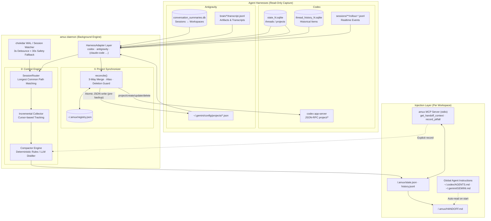

<div align="center">

```
  █████╗ ███╗   ███╗██╗   ██╗██╗  ██╗
 ██╔══██╗████╗ ████║██║   ██║╚██╗██╔╝
 ███████║██╔████╔██║██║   ██║ ╚███╔╝ 
 ██╔══██║██║╚██╔╝██║██║   ██║ ██╔██╗ 
 ██║  ██║██║ ╚═╝ ██║╚██████╔╝██╔╝ ██╗
 ╚═╝  ╚═╝╚═╝     ╚═╝ ╚═════╝ ╚═╝  ╚═╝
```

### The `tmux` for AI Coding Agents.

**Stop Agent Amnesia.** Seamlessly synchronize projects, handoff distilled context, and share hard-earned pitfall memory across **Codex**, **Antigravity**, **Claude Code**, and beyond.

[](https://www.npmjs.com/package/amux)
[](LICENSE)
[](package.json)
[](https://modelcontextprotocol.io)
[](CONTRIBUTING.md)

[English](README.md) · [简体中文](README_CN.md) · [Architecture Guide](docs/architecture.md) · [Report Bug](https://github.com/study8677/amux/issues)

</div>

---

## ⚡ The Problem: "Agent Amnesia"

When you pair-program with multiple AI coding agents, you constantly face **Agent Amnesia**:

```
                       ┌──────────────────────┐
                       │   Codex (CLI / IDE)  │ ────► Spends 45 mins debugging an obscure SSL bug.
                       └──────────┬───────────┘       Finds that node-fetch fails with HTTP/2.
                                  │
                               SWITCH
                                  │
                                  ▼
                       ┌──────────────────────┐
                       │  Antigravity / etc.  │ ────► 💥 BLIND TO THE PAST:
                       └──────────────────────┘       Repeats the exact same failed attempts!
                                                      Wastes tokens, breaks code, burns time.
```

- **Siloed Project Lists**: Create a project in Codex; Antigravity has no clue it exists. Rename a workspace in one tool, the other drifts.
- **Context Fragmentation**: Switching tools requires copy-pasting bloated prompt dumps and re-explaining the entire architecture.
- **Duplicate Pitfalls**: If Agent A discovered that `npm run build` fails under Python 3.12, Agent B will happily try it again 10 minutes later.

---

## 💡 The Solution: Meet `amux`

`amux` runs as an ultra-lightweight, zero-lock background daemon on your machine. It sits underneath your AI coding harnesses like an invisible hypervisor:

```
┌────────────────────────────────────────────────────────────────────────┐
│                              amux DAEMON                               │
│                                                                        │
│   Codex SQLite / WAL  ◄───[ Read-Only Sniffer ]───►  Antigravity DB    │
│           │                                                │           │
│           ▼                                                ▼           │
│  [ Normalized Event Stream ]  ──────►  [ Distillation & Compactor ]    │
│                                                │                       │
│                                                ▼                       │
│                           .amux/HANDOFF.md                             │
│                         (Goals, Decisions,                             │
│                      ⛔ Tried & Failed Memory)                         │
└──────────────────────────────────────┬─────────────────────────────────┘
                                       │
                    ┌──────────────────┴──────────────────┐
                    ▼                                     ▼
        [ Global Rules Auto-Injection ]        [ Built-in MCP Server ]
         (~/.codex/AGENTS.md & GEMINI.md)       (get_handoff_context, etc.)
```

Whenever you switch between agents, the new agent **immediately knows**:
- 🎯 **What the current objective is**
- 🏛️ **Which architectural decisions were made**
- ⛔ **What was already tried and failed (so it will NEVER repeat the mistake)**
- 📂 **Which files are active right now**

---

## 🌟 Key Features

| Capability | What `amux` Does | Why It Matters |
|---|---|---|
| 🔄 **Bidirectional Project Mirroring** | Two-way project synchronization across Codex, Antigravity, and registry with 3-way merge. | Create/rename/delete a project in any tool — all other harnesses sync in real-time. |
| 🧠 **Cross-Harness Context Relay** | Passively listens to SQLite WAL & transcripts, continuously distilling sessions into `.amux/HANDOFF.md`. | Switch between agents without re-explaining context or dumping tokens. |
| ⛔ **Pitfall Memory (`Tried & Failed`)** | Automatically detects failed terminal commands, user refutations ("that didn't work"), and rollbacks. | Prevents Agent B from repeating the dead ends Agent A already explored. |
| 🔌 **Zero-Friction Injection** | Injects instructions into global agent rule files (`AGENTS.md`, `GEMINI.md`) + provides a native MCP server. | Agents read and write handoff notes autonomously without changing your git workflow. |
| 🛡️ **Industrial Safety Guardrails** | 100% read-only sniffer, zero SQLite locks (`immutable=1`), official Codex API writes only, delete guards. | Guaranteed zero corruption to your agent databases or project files. |
| 🌲 **Clean Git Footprint** | Automatically appends `.amux/` to `.git/info/exclude`. | Zero clutter in your git status or repository commit history. |

---

## 🚀 Quickstart in 60 Seconds

### 1. Installation

```bash
git clone https://github.com/study8677/amux.git && cd amux
npm install && npm run build
npm link      # Provides the global `amux` CLI
```

> **Requirements**: Node.js ≥ 20 (Node 22+ recommended with native `node:sqlite` fallback).

### 2. One-Time Setup

Inject global rules into Codex and Antigravity, and register the built-in MCP server:

```bash
amux setup
```

*(Creates automatic safety backups of any modified configuration files).*

### 3. Sync Existing Projects

```bash
amux projects sync        # Preview cross-harness alignment plan (Dry-Run)
amux projects sync --yes  # Execute synchronization
```

### 4. Start the Background Daemon

```bash
amux daemon start         # Backfills past history & starts live event monitoring
amux daemon logs -f       # Stream live sync activity
```

That's it! Open your agents and code as you normally do. `amux` handles the rest in the background.

---

## 📺 Live Experience

```console
$ amux daemon logs -f

[19:30:02] [Codex → amux] project "NexusCore": Captured 3 new conversation turns
[19:30:05] [Compactor] Distilled new objective: "Migrate auth service to JWT RS256"
[19:30:06] [Compactor] ⛔ Detected Pitfall: "openssl genpkey -algorithm ed25519 failed (unsupported in v1.2)"
[19:30:06] [Storage] Updated .amux/HANDOFF.md for NexusCore
[19:31:40] [Antigravity → amux] Agent loaded handoff context via MCP: 4 decisions, 1 pitfall preserved
[19:32:15] [Projects] Codex created project "MediaKit" → Mirrored to Antigravity
```

---

## 📄 Inside `.amux/HANDOFF.md`

`amux` synthesizes a deterministic, structured markdown file in your project's `.amux/` directory:

```markdown
# amux Handoff Context
> Last updated: 2026-11-09 19:30:06 by Codex | amux v0.1.0

## 🎯 Current Objective
- Migrate auth service to JWT RS256 and remove legacy session cookies.
- Pending task: Update test suite in `tests/auth_test.go`.

## ⛔ Tried & Failed (Do Not Repeat)
- `openssl genpkey -algorithm ed25519`: Target runtime does not support ed25519 certs. Use RS256 only.
- Direct cookie mutation in middleware: Causes race condition in concurrent requests.

## 🏛️ Key Decisions
- Switched token validation from HMAC-SHA256 to RS256 public key verification.
- User constraint: Do NOT modify existing database schema.

## 📂 Active Hotspots
- `src/auth/jwt.go` (Modified 4 times)
- `src/middleware/auth.go` (Modified 2 times)

## 💬 Recent Dialogue Summary
- [Codex] Scaffolded RS256 token verification logic.
- [User] Confirmed private key location at `/etc/certs/auth.key`.
```

---

## 🏗️ Architecture



Read the full technical specification in [docs/architecture.md](docs/architecture.md).

---

## 🛠️ CLI Cheatsheet

```bash
# Daemon Management
amux daemon start                 # Start background daemon
amux daemon stop                  # Stop background daemon
amux daemon status                # Check daemon health & watcher statistics
amux daemon logs -f               # Follow daemon log output

# Project Alignment
amux projects list                # View unified project table across harnesses
amux projects sync                # Dry-run project reconciliation
amux projects sync --yes          # Apply project synchronization
amux projects exclude <path|name> # Exclude specific workspace from sync

# Context & Inspection
amux status                       # Show current repository's handoff summary
amux sync [--dry-run]             # Manually trigger capture for current directory
amux watch                        # Foreground live watcher for current workspace
amux setup [--remove]             # Install / uninstall global rules & MCP config

# Protocol Server
amux mcp                          # Run Model Context Protocol stdio server
```

---

## 🛡️ Industrial Security & Safety Design

- 🔒 **Immutable SQLite Reads**: Every harness database is opened in strict read-only mode (`immutable=1` when WAL is clean) to prevent lock contention or corruption.
- 🚦 **Zero Direct Codex DB Writes**: Projects are manipulated strictly through the official `codex app-server` JSON-RPC API, with pre-mutation SQLite backups.
- 💾 **Atomic File Writes**: Antigravity JSON configuration files are updated using atomic rename swaps with complete directory backups prior to modification.
- 🛑 **Destructive Action Guardrails**: Deletions only propagate for confirmed pairs. Any batch deletion exceeding 2 workspaces halts automatically until manual `--yes` authorization.
- 🪶 **Zero Git Pollution**: Automatically registers `.amux/` in `.git/info/exclude`. Your teammates will never see unsolicited configuration commits.

---

## 🗺️ Harness Support & Roadmap

- [x] **Codex** (Full support: Projects, Threads, Real-time JSONL, App-Server RPC)
- [x] **Antigravity** (Full support: Projects JSON, Transcripts, Summaries DB, Brain artifacts)
- [ ] **Claude Code** (*In Development*)
- [ ] **Cursor / Windsurf** (*Planned*)
- [ ] **OpenCode / Aider** (*Planned*)

---

## ⚙️ Configuration

Stored in `~/.amux/config.json`:

```json
{
  "projects": {
    "exclude": ["/Users/me/SecretProject"],
    "propagateDeletes": true,
    "maxAutoDeletes": 2
  },
  "context": {
    "backfillDays": 0,
    "debounceMs": 3000,
    "windowEvents": 400
  }
}
```

Optional LLM-powered distillation (falls back gracefully to deterministic rule extractor):
```bash
export AMUX_LLM_API_KEY="sk-..."
export AMUX_LLM_BASE_URL="https://api.openai.com/v1"
export AMUX_LLM_MODEL="gpt-4o-mini"
```

---

## 🤝 Contributing

We welcome contributions from developers across all agent ecosystems!

1. Fork the repository
2. Create your feature branch (`git checkout -b feature/harness-claude-code`)
3. Commit your changes (`git commit -m 'feat: add Claude Code adapter'`)
4. Push to the branch (`git push origin feature/harness-claude-code`)
5. Open a Pull Request

See [`src/harness/types.ts`](src/harness/types.ts) to learn how to add adapters for new AI coding tools in under 100 lines of code.

---

## 📄 License

Distributed under the MIT License. See [LICENSE](LICENSE) for more information.

<div align="center">

**amux** — Made for developers who refuse to compromise on AI agent workflow speed.

[⭐ Star us on GitHub](https://github.com/study8677/amux)

</div>
