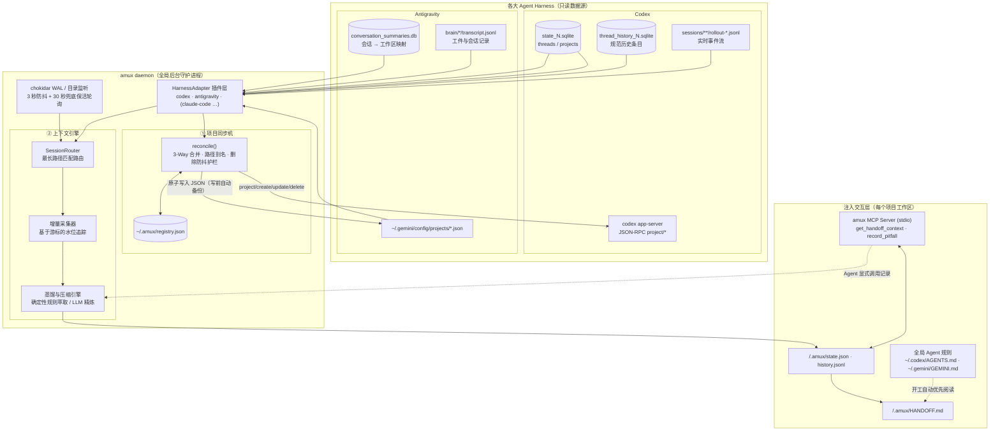

<div align="center">

```
  █████╗ ███╗   ███╗██╗   ██╗██╗  ██╗
 ██╔══██╗████╗ ████║██║   ██║╚██╗██╔╝
 ███████║██╔████╔██║██║   ██║ ╚███╔╝ 
 ██╔══██║██║╚██╔╝██║██║   ██║ ██╔██╗ 
 ██║  ██║██║ ╚═╝ ██║╚██████╔╝██╔╝ ██╗
 ╚═╝  ╚═╝╚═╝     ╚═╝ ╚═════╝ ╚═╝  ╚═╝
```

### AI Coding Agents 界的 `tmux`

**告别 Agent 失忆症（Agent Amnesia）。** 让 **Codex**、**Antigravity**、**Claude Code** 等多个 AI 编程智能体在同一台电脑上**共享项目列表、无缝接力上下文、同步避坑记忆**。

[](https://www.npmjs.com/package/amux)
[](LICENSE)
[](package.json)
[](https://modelcontextprotocol.io)
[](CONTRIBUTING.md)

[English](README.md) · [简体中文](README_CN.md) · [架构设计详解](docs/architecture.md) · [反馈问题](https://github.com/study8677/amux/issues)

</div>

---

## ⚡ 核心痛点：为什么多 Agent 编程如此折磨？

当你在同一个项目中同时使用多个 AI Agent 结对编程时，必然会撞上**智能体失忆症（Agent Amnesia）**：

```
                       ┌──────────────────────┐
                       │   Codex (CLI / IDE)  │ ────► 花了 45 分钟深入排查一个刁钻的 OAuth 报错，
                       └──────────┬───────────┘       排除了 4 种错误方案，最终定位到了根因。
                                  │
                                切换工具
                                  │
                                  ▼
                       ┌──────────────────────┐
                       │  Antigravity / etc.  │ ────► 💥 过去的探索全盲：
                       └──────────────────────┘       新 Agent 把那 4 种失败方案从头又踩了一遍！
                                                      疯狂浪费 Token，还搞崩了你的配置。
```

- **项目彼此孤岛**：Codex 里建了个新项目，Antigravity 里根本看不见；改了项目名，另一侧直接失联。
- **上下文彻底断层**：切到新 Agent，必须重新手动复制长篇大论的 Prompt，重讲一遍系统架构和当前进度。
- **重复踩已踩过的坑**：Agent A 验证过某命令在 macOS 上跑不通，Agent B 几分钟后又会自信满满地执行同一行报错命令。

---

## 💡 解决方案：`amux`（Agent Multiplexer）

`amux` 作为轻量级、无锁的全局后台守护进程（Daemon）常驻本机，像透明的虚拟机管理器一样贯穿所有 AI Agent：

```
┌────────────────────────────────────────────────────────────────────────┐
│                              amux DAEMON                               │
│                                                                        │
│   Codex SQLite / WAL  ◄───[ 只读嗅探采集器 ]───►  Antigravity DB       │
│           │                                                │           │
│           ▼                                                ▼           │
│    [ 标准化事件流 ]   ────────►  [ 提炼与压缩引擎 Compactor ]           │
│                                                │                       │
│                                                ▼                       │
│                           .amux/HANDOFF.md                             │
│                         (当前目标、架构决策、                          │
│                      ⛔ Tried & Failed 避坑记录)                       │
└──────────────────────────────────────┬─────────────────────────────────┘
                                       │
                    ┌──────────────────┴──────────────────┐
                    ▼                                     ▼
           [ 全局规则自动注入 ]                   [ 内置 MCP Server ]
     (~/.codex/AGENTS.md & GEMINI.md)       (get_handoff_context 等工具)
```

当你从一个 Agent 切换到另一个时，新 Agent **秒级心领神会**：
- 🎯 **当前正在攻克的核心目标是什么**
- 🏛️ **已经敲定了哪些架构和技术决策**
- ⛔ **哪些尝试已经失败了（坚决避开，绝不二次踩坑）**
- 📂 **当前最活跃的热点文件有哪些**

---

## 🌟 核心特性

| 功能模块 | `amux` 怎么做 | 带来的革命性体验 |
|---|---|---|
| 🔄 **项目列表双向镜像** | 跨 Codex、Antigravity 与本地 Registry 保持双向对齐，具备 3-way 智能合并机制。 | 任意一处新建、重命名、更改路径或删除项目，其他 Harness 实时同步。 |
| 🧠 **上下文实时接力** | 静默嗅探 SQLite WAL 与会话日志，自动提取关键进展写入 `.amux/HANDOFF.md`。 | 切换 Agent 无需大段 Prompt 复述，告别 Token 倾倒与冷启动。 |
| ⛔ **避坑记忆（`Tried & Failed`）** | 自动捕获终端报错、依赖失败、用户否定（“不对/报错了/回滚”）以及回滚记录。 | 全球首创跨 Agent 避坑黑名单，杜绝新 Agent 犯相同的蠢错误。 |
| 🔌 **零侵入感注入** | 全局规则自动追加（`AGENTS.md` / `GEMINI.md`） + 内置 Model Context Protocol (MCP) 服务。 | Agent 启动时自主阅读交接文档，也可主动通过 MCP 写入关键决策。 |
| 🛡️ **工业级安全护栏** | 100% 只读嗅探、零锁竞争（`immutable=1`）、Codex 只走官方 API、批量删除安全熔断。 | 杜绝加写锁冲突，保障 IDE 与 Agent 原生数据的绝对安全。 |
| 🌲 **Git 零污染** | 自动向各项目 `.git/info/exclude` 注册 `.amux/` 忽略规则。 | 绝不向你的 git 仓库产生脏提交或意外修改，团队合作毫无压力。 |

---

## 🚀 60 秒极速上手

### 1. 安装

```bash
git clone https://github.com/study8677/amux.git && cd amux
npm install && npm run build
npm link      # 注册全局 `amux` 命令行
```

> **系统要求**：Node.js ≥ 20（推荐 Node 22+，内置 `node:sqlite` 作为强力兜底引擎）。

### 2. 一次性全局初始化

向 Codex 和 Antigravity 注入全局引导规则，并自动注册 amux 内置的 MCP Server：

```bash
amux setup
```

*(修改前会自动对系统原配置文件创建时间戳备份，安全无虞)。*

### 3. 对齐已有项目

```bash
amux projects sync        # 预览对齐计划（Dry-Run，安全不落盘）
amux projects sync --yes  # 确认执行双向同步
```

### 4. 启动后台守护进程

```bash
amux daemon start         # 自动补全历史上下文，开启全局实时嗅探
amux daemon logs -f       # 追踪实时同步流
```

搞定！接下来按你平时的习惯使用 Codex 或 Antigravity 即可，`amux` 会在后台静默完成一切协同。

---

## 📺 实时运行效果展示

```console
$ amux daemon logs -f

[19:30:02] [Codex → amux] 项目「NexusCore」：捕获 3 轮新对话
[19:30:05] [Compactor] 提炼最新目标："将鉴权服务迁移至 JWT RS256 架构"
[19:30:06] [Compactor] ⛔ 捕获失败踩坑："openssl genpkey -algorithm ed25519 失败 (目标环境缺少算法支持)"
[19:30:06] [Storage] 成功更新 NexusCore 的 .amux/HANDOFF.md
[19:31:40] [Antigravity → amux] 新 Agent 通过 MCP 载入上下文：继承 4 项架构决策，1 项避坑提示
[19:32:15] [Projects] Codex 新建项目「MediaKit」→ 自动镜像同步至 Antigravity
```

---

## 📄 实战解剖：`.amux/HANDOFF.md` 生成样例文档

`amux` 在项目根目录的 `.amux/` 下自动生成极其精准精炼的结构化 Markdown：

```markdown
# amux Handoff Context
> 上次更新：2026-11-09 19:30:06 来自 Codex | amux v0.1.0

## 🎯 当前目标 (Current Objective)
- 将认证服务切换至 JWT RS256 方案，并移除旧版 Session Cookies。
- 待办项：更新 `tests/auth_test.go` 中的测试用例。

## ⛔ 踩坑与失败尝试 (Tried & Failed - 切勿重复尝试)
- `openssl genpkey -algorithm ed25519`：部署机环境 openssl 不支持 ed25519，请严格使用 RS256 算法。
- 在中间件中直接修改 Cookie：并发请求时会发生竞态条件。

## 🏛️ 关键架构决策 (Key Decisions)
- Token 验证逻辑由 HMAC-SHA256 切换为公钥验证。
- 用户硬性约束：严禁改动现有数据库 Users 表结构。

## 📂 活跃热点文件 (Active Hotspots)
- `src/auth/jwt.go` (改动 4 次)
- `src/middleware/auth.go` (改动 2 次)

## 💬 最近对话摘要 (Recent Dialogue)
- [Codex] 完成了基于 RS256 的公钥验签模块。
- [User] 确认了私钥挂载路径位于 `/etc/certs/auth.key`。
```

---

## 🏗️ 整体架构流程



详细的设计推导与原理解析请阅读 [docs/architecture.md](docs/architecture.md)。

---

## 🛠️ CLI 命令速查表

```bash
# 守护进程管理
amux daemon start                 # 启动全局后台守护进程
amux daemon stop                  # 停止后台守护进程
amux daemon status                # 查看守护进程运行状态与监听指标
amux daemon logs -f               # 实时追踪运行日志

# 项目同步对齐
amux projects list                # 查看跨工具统一项目视图与配对状态
amux projects sync                # 预览项目对齐方案（Dry-Run）
amux projects sync --yes          # 执行对齐写入
amux projects exclude <path|name> # 排除指定目录或项目

# 状态与上下文
amux status                       # 查看当前项目的交接状态摘要
amux sync [--dry-run]             # 手动触发当前工作区上下文同步
amux watch                        # 在前台实时观察当前项目（监控看板模式）
amux setup [--remove]             # 一键挂载/卸载全局规则与 MCP 配置

# 标准协议服务
amux mcp                          # 运行标准 Model Context Protocol (stdio)
```

---

## 🛡️ 工业级安全与稳健性设计

- 🔒 **只读无锁嗅探**：所有 Agent 的 SQLite 库均以严格的只读模式打开（WAL 干净时开启 `immutable=1`），杜绝数据库锁争用与损坏风险。
- 🚦 **拒绝直接修改 Codex SQLite**：项目操作严守官方 `codex app-server` 的 JSON-RPC 协议；写前自动打快照。
- 💾 **原子化安全落盘**：Antigravity JSON 配置文件采用临时文件写入 + 原子性重命名，首次写入前整目录备份。
- 🛑 **误操作防御护栏**：删除操作只在已配对的历史项目间传播；单轮检测到超过 2 个删除时自动挂起保护，必须人工 `--yes` 授权。
- 🪶 **Git 仓库零侵入**：自动将 `.amux/` 写入项目的 `.git/info/exclude`，完全不打扰团队代码仓库提交历史。

---

## 🗺️ 工具生态与路线图

- [x] **Codex**（已全面支持：Projects、Threads、实时 JSONL、App-Server RPC）
- [x] **Antigravity**（已全面支持：Projects JSON、Transcripts 日志、Summaries DB、工件提炼）
- [ ] **Claude Code**（*正在积极开发中*）
- [ ] **Cursor / Windsurf**（*规划中*）
- [ ] **OpenCode / Aider**（*规划中*）

---

## ⚙️ 个性化配置

配置文件位于 `~/.amux/config.json`：

```json
{
  "projects": {
    "exclude": ["/Users/me/SecretProject"],
    "propagateDeletes": true,
    "maxAutoDeletes": 2
  },
  "context": {
    "backfillDays": 0,
    "debounceMs": 3000,
    "windowEvents": 400
  }
}
```

可选的 LLM 蒸馏功能（如未配置，默认使用高吞吐、零开销的确定性规则引擎）：
```bash
export AMUX_LLM_API_KEY="sk-..."
export AMUX_LLM_BASE_URL="https://api.openai.com/v1"
export AMUX_LLM_MODEL="gpt-4o-mini"
```

---

## 🤝 欢迎贡献

欢迎来自各大 Agent 生态社区的开发者一起添砖加瓦！

1. Fork 本仓库
2. 创建特性分支 (`git checkout -b feature/harness-claude-code`)
3. 提交你的修改 (`git commit -m 'feat: add Claude Code adapter'`)
4. 推送分支 (`git push origin feature/harness-claude-code`)
5. 发起 Pull Request

查看 [`src/harness/types.ts`](src/harness/types.ts)，只需百行代码即可轻松为你喜爱的 AI 编程助手开发专用适配器。

---

## 📄 开源许可证

本项目基于 [MIT](LICENSE) 许可证开源。

<div align="center">

**amux** — 专为拒绝在 AI 编程流转中浪费时间的极客打造。

[⭐ 欢迎在 GitHub 上为我们点亮 Star](https://github.com/study8677/amux)

</div>
