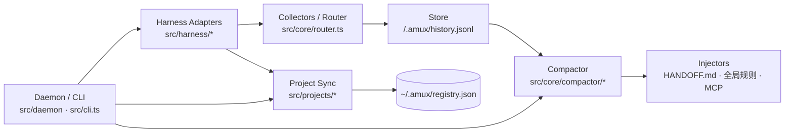
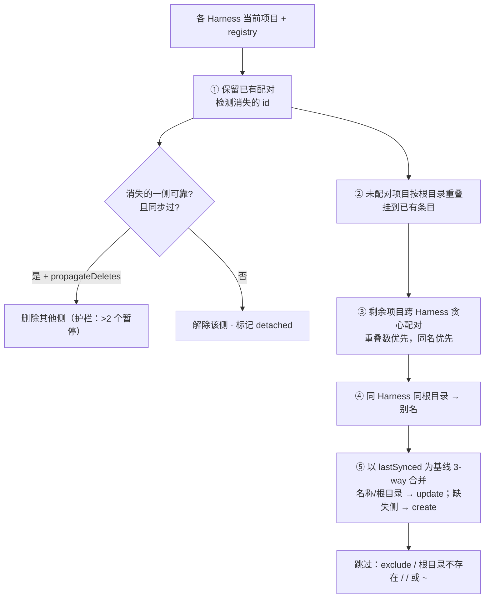

# amux 架构设计

## 分层

| 层 | 目录 | 职责 |
|---|---|---|
| Harness 适配器 | `src/harness/` | 每个 Agent 工具一个适配器：会话发现、增量解析、项目读写 |
| 路由 / 采集 | `src/core/router.ts`、`src/core/engine.ts` | 会话 → 项目（最长根目录前缀），按游标增量采集 |
| 存储 | `src/core/store.ts` | 每个项目 `.amux/` 下的 state / history / cursors / manual |
| 蒸馏 | `src/core/compactor/` | Rule-based（默认）+ LLM（可选，失败回退） |
| 注入 | `src/injectors/` | HANDOFF.md 渲染、标记块、全局规则与 MCP 注册 |
| 项目同步 | `src/projects/` | `reconcile()` 纯函数 + 执行层 |
| 进程 | `src/daemon/`、`src/mcp/`、`src/cli.ts` | 守护进程、MCP Server、命令行 |

## 数据源（Phase 1 探测结论）

### Codex
- `state_N.sqlite → threads`：会话 id、`cwd`、`rollout_path`、`agent_role`（子 Agent 过滤）。
- `state_N.sqlite → projects / project_roots`：项目列表（读）。
- `thread_history_N.sqlite → thread_items`：**历史会话的规范存储**（旧 rollout 文件会被清理），按 `MAX(rollout_ordinal, updated_at_ordinal)` 增量读取，进行中的命令在完成后被重新捕获。
- `sessions/**/rollout-*.jsonl`：仍存在的实时会话，按字节偏移增量读取；解析 `event_msg/item_completed`，并兼容旧版 `*_end` 事件。行级正则预过滤，跳过 base_instructions 等大行。
- 写入：`codex app-server`（stdio JSON-RPC，`experimentalApi`）的 `project/create|update|delete`。

### Antigravity
- `conversation_summaries.db`：会话 → `workspace_uris`（百分号编码的 file URI），过滤子会话。
- `brain/<id>/.system_generated/logs/transcript.jsonl`：`USER_INPUT` / `PLANNER_RESPONSE(tool_calls)` / `GENERIC`（每个工具调用恰好一行结果，按队列配对，队列随游标持久化）。
- `brain/<id>/task.md`、`implementation_plan.md`：工件摘要，按内容 hash 去重。
- `~/.gemini/config/projects/*.json`：项目列表（读写）。

## 项目同步算法（`reconcile`）

## 上下文蒸馏规则（RuleBasedCompactor）

| 字段 | 规则 |
|---|---|
| `currentObjective` | 最近一条非"继续/好的"的用户消息首段 + 同会话 task.md 未完成项 |
| `triedAndFailed` | 失败命令（过滤纯探索命令、之后成功过的命令）、`command not found` 环境坑、用户否定（"不对/回滚/还是报错"）→ 上一轮 Agent 做法、Agent 最终回答中的失败自述、手动记录（置顶） |
| `decisions` | 批准的计划（附计划标题与章节）、用户约束（"不要/必须/禁止"）、最终回答中的决策句、手动记录 |
| `activeFiles` | 项目根目录内的文件改动按频次 × 新近度排序，附带意图（所在轮的用户请求），补充 git 未提交文件 |
| `recentTurns` | 各 Harness 按时间合并后最近 5 轮 |

## 运行时

- **守护进程**：启动 → 项目同步 → 全量回溯（按项目串行）→ 监听 `*.db-wal`、Codex 当日会话目录、Antigravity projects 目录；会话发现基于 DB 水位线，每项目 3s 防抖，30s 兜底轮询，5 分钟项目同步兜底。
- **MCP**：全局注册一个 stdio 服务，工具通过 `workspace` 参数定位项目（MCP 进程的 cwd 不一定是项目目录）。
